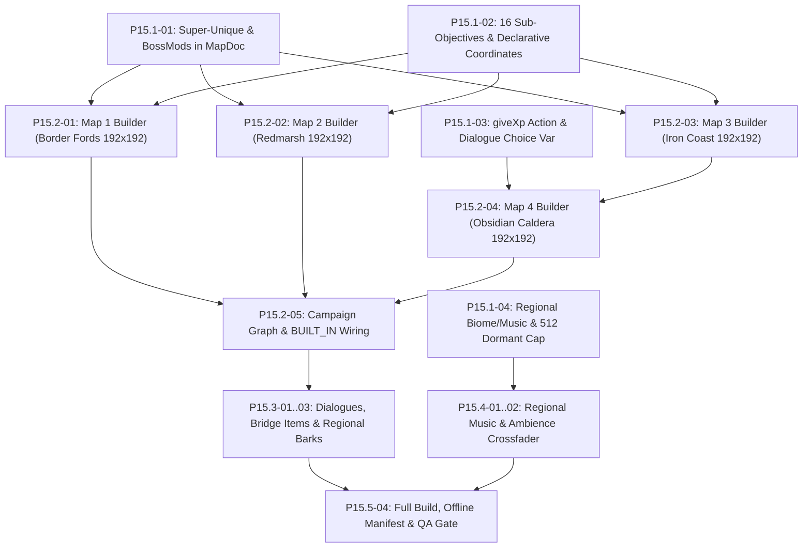

# CAMPAIGN PRODUCTION PLAN & GSD TASK MATRIX (`02-PRODUCTION-PLAN`)

## 1. Execution Philosophy & Parallel Safety Rules

- **Small Atomic Commits**: Every task below is a single self-contained commit verified by `npx tsc --noEmit`, `node tools/check-repo.mjs`, `npm run check:atlases`, and `npx vitest run` before pushing to `origin/main`.
- **Non-Overlapping File Ownership**: Tasks are partitioned into five tracks (**Track A: Engine Gaps**, **Track B: 4 Huge Maps & Scripts**, **Track C: Dialogues & Lore**, **Track D: Music & Audio**, **Track E: Map Art & Roster Hooks**) so two agents can execute orthogonal tracks in parallel without merge conflicts.
- **Protected Files (Never Touch)**: `src/sim/path.ts`, `tests/movement.test.ts`, `models/`, `tools/render-unit.py`.

---

## 2. Master GSD Phase & Task Breakdown

### Phase 15.1 — Engine Gaps for Macro Maps (`03-GAPS.md` Resolution)

| Task ID | Task Title | Target Files | Depends On | Effort | Verification Gate |
|---------|------------|--------------|------------|--------|-------------------|
| **P15.1-01** | **GAP-01**: Add 5 Super-Unique bossMods (`lightning_enchanted`, `extra_strong`, `cursed`, `mana_burn`, `teleporting`) to `BOSS_MOD_IDS` and allow `monsterFamilyById` / `validate()` to resolve all 16 `SUPER_UNIQUES` declaratively. | `src/mapdoc.ts`, `src/sim/data.ts`, `tests/mapdoc.test.ts` | None | **XS** (~25 LOC, 10 min) | `npx vitest run tests/mapdoc.test.ts` |
| **P15.1-02** | **GAP-02**: Expand `ScriptState.sub` from 8 to 16 slots (`sub[0..15]`) and parse `obj.N.pos` (`"x,y"`) and `obj.N.kind` (`"main"\|"side"`) in `MissionUi.evaluateQuestDossier` for declarative 12-quest auto-navigation. | `src/sim/script.ts`, `src/missionui.ts`, `tests/mission.test.ts` | None | **S** (~45 LOC, 15 min) | `npx vitest run tests/mission.test.ts` |
| **P15.1-03** | **GAP-03 & GAP-04**: Add `giveXp` action to `ACTIONS` in `src/sim/script.ts` and wire Disco Elysium dialogue choice clicks (`[1]`, `[2]`, `[3]`) to set `msg.N.var` in `st.vars` for deterministic story branching (`Threshold Choice`). | `src/sim/script.ts`, `src/missionui.ts`, `tests/script-branching.test.ts` | `P15.1-02` | **S** (~50 LOC, 20 min) | `npx vitest run tests/script-branching.test.ts` |
| **P15.1-04** | **GAP-05 & GAP-06**: Support optional `{ biome?, zone?, music?, ambience? }` on `MapDoc.regions` for regional exploration music crossfading, and allow up to `512` total `doc.units` when active non-dormant units `<= 300`. | `src/mapdoc.ts`, `src/audiologic.ts`, `tests/mapdoc.test.ts` | `P15.1-01` | **M** (~65 LOC, 25 min) | `npx vitest run tests/mapdoc.test.ts` |

---

### Phase 15.2 — Building the 4 Huge Maps (`192x192` Declarative `MapDoc` v2 Generators)

Each huge map is generated by a deterministic builder script in `tools/make-macro-mapN.mjs` (following `declarative-mission-author`), emitting a diffable `src/missions/mapN-<slug>.map.json` validated by `loadDoc()` and a dedicated headless Vitest playability test.

| Task ID | Task Title | Target Files | Depends On | Effort | Verification Gate |
|---------|------------|--------------|------------|--------|-------------------|
| **P15.2-01** | **Map 1 Builder (`The Border Fords & Weeping Ossuary`)**: `192x192` map with Thornwick Market hub (`House 0..2`), 6 regions (Sunken Ford, Fenwick Peat & Lantern Passage, Greywood & Kilns, Craghorn & Alder Bridge, Ravenwatch & Weeping Ossuary, Undervault & Ashbrook Gate), 7 waypoints, 6 shrines, 4 adventure objects, 4 Super-Uniques, Boss `morvessa`, and 12 quest triggers. | `tools/make-macro-map1.mjs`, `src/missions/map1-border-fords.map.json`, `tests/macro-map1.test.ts` | `P15.1-01`, `P15.1-02` | **M** (~350 LOC script, 30 min) | `npx vitest run tests/macro-map1.test.ts` |
| **P15.2-02** | **Map 2 Builder (`The Redmarsh Wastes & Ironheart Cisterns`)**: `192x192` map with Redmarsh Outpost hub, 6 regions (Ochre Ditch & Corduroy Causeway, Twin Passes & Bracken Basin, Quartz Plateau & Wardstone Ring, Third-Dynasty Salt-Vaults, Deep Quarry Terraces, Fork of Spears & Ironheart Bastion), 7 waypoints, 6 shrines, 4 Super-Uniques (`Zara`, `Vekor`, `Ssorath`, `Khepri`), Boss `gorrathul`, and 12 quest triggers. | `tools/make-macro-map2.mjs`, `src/missions/map2-redmarsh-wastes.map.json`, `tests/macro-map2.test.ts` | `P15.1-01`, `P15.1-02` | **M** (~350 LOC script, 30 min) | `npx vitest run tests/macro-map2.test.ts` |
| **P15.2-03** | **Map 3 Builder (`The Iron Coast & Drowned Citadel`)**: `192x192` map with Oakhaven Harbor hub, 6 regions (Cinder Wards & Blighted Orchard, Greywash Canal & Riverlock Crossing, Hourglass Spit & Smuggler Caves, Sunken Citadel & Drowned Choir, Starved Bastion & Cliff Culverins, Burning Harborwatch), 7 waypoints, 6 shrines, 4 Super-Uniques (`Ignisweb`, `Zulmar`, `Valkor`, `Elder Thunderbough`), Boss `vesperion`, and 12 quest triggers. | `tools/make-macro-map3.mjs`, `src/missions/map3-iron-coast.map.json`, `tests/macro-map3.test.ts` | `P15.1-01`, `P15.1-02` | **M** (~350 LOC script, 30 min) | `npx vitest run tests/macro-map3.test.ts` |
| **P15.2-04** | **Map 4 Builder (`The Obsidian Caldera & Cinder Throne`)**: `192x192` map with Ironcamp Forge-Hold hub, 6 regions (Basalt Highway & Shattered Beacons, Besieged Wall & Ashveil Summit, Magnetic Narrows & Twofold Barbican, Gauntlet of Iron & Greystone Rampart, Three-Roads Watch & Headless Kings, Colonnade of Crowns & Obsidian Dais), 7 waypoints, 6 shrines, 4 Super-Uniques (`Vaelor`, `Kragg`, `Gorgath`, `Lord Varakh`), Boss `ashkarath`, 12 quests, and dual ending triggers (`Ending A` vs `Ending B`). | `tools/make-macro-map4.mjs`, `src/missions/map4-obsidian-caldera.map.json`, `tests/macro-map4.test.ts` | `P15.1-03`, `P15.2-03` | **M** (~380 LOC script, 35 min) | `npx vitest run tests/macro-map4.test.ts` |
| **P15.2-05** | **Campaign Graph & Registration Wiring**: Register `map1-border-fords`..`map4-obsidian-caldera` in `src/mission.ts` (`BUILT_IN`) and wire the 4-Hub / 4-Map node graph in `public/data/campaign.json` while preserving backward compatibility for legacy save IDs. | `src/mission.ts`, `public/data/campaign.json`, `tests/campaign.test.ts` | `P15.2-01`..`04` | **S** (~60 LOC, 15 min) | `npx vitest run tests/campaign.test.ts` |

---

### Phase 15.3 — Dialogues, Lore Items & Quest Content

| Task ID | Task Title | Target Files | Depends On | Effort | Verification Gate |
|---------|------------|--------------|------------|--------|-------------------|
| **P15.3-01** | **48-Quest Cognitive Dialogues & Stances**: Author full Disco Elysium cognitive dialogues (`[WAR LOGIC]`, `[ASTRAL SHIVER]`, `[QUARTERMASTER'S EYE]`, `[PRIMORDIAL RECKONING]`, sensory beats `*(...)*`, and 3 player stances) for all 48 quests and 20 NPCs across Maps 1–4. | `public/data/content/missions.json`, `public/data/content/mission-texts.json` | `P15.2-05` | **M** (~400 lines JSON, 25 min) | `node tools/check-repo.mjs` |
| **P15.3-02** | **Bridge Artifacts & Lore Book Drops**: Wire the 12 act-bridging quest items (*Morvessa's Brass Seal Ring*, *Vitrified Slag Focus*, *Gorrathul's Shield-Core*, *Third-Dynasty Hydraulic Charts*, *Vesperion's Astrolabe*, *Age-of-Chains Rune-Tablet*, *Star-Iron Billets*, *First Watch Oath Ring*) into `public/data/items.json` and `public/data/content/item-flavor.json`. | `public/data/items.json`, `public/data/content/item-flavor.json`, `tests/loot.test.ts` | `P15.1-03` | **S** (~120 lines JSON, 15 min) | `npx vitest run tests/loot.test.ts` |
| **P15.3-03** | **Pack 20 Barks & Regional Entry Lines**: Wire regional entry flavor (`rf-a1`..`rf-a4`) and town ambient barks (`town-barks.json`) to trigger when entering each of the 24 named macro regions. | `src/missioncontent.ts`, `public/data/content/town-barks.json` | `P15.2-05` | **S** (~50 LOC, 15 min) | `npx vitest run tests/audio.test.ts` |

---

### Phase 15.4 — Music, Ambience & Regional Soundscapes

| Task ID | Task Title | Target Files | Depends On | Effort | Verification Gate |
|---------|------------|--------------|------------|--------|-------------------|
| **P15.4-01** | **Regional Music & Ambience Crossfader**: Connect the 18 existing procedural AAC tracks (`music_town_*`, `music_explore_act1..4_*`, `music_battle_act1..4`, `music_boss_*`) and 14 regional ambience loops (`amb_*`) in `src/audiologic.ts` to the hero's current region on the 4 huge maps. | `src/audiologic.ts`, `tests/audio-balance.test.ts` | `P15.1-04` | **S** (~70 LOC, 20 min) | `npx vitest run tests/audio-balance.test.ts` |
| **P15.4-02** | **Missing Sub-Region Stingers (Optional Synth Pass)**: If any regional cue needs distinct variation (e.g., *Weeping Ossuary*, *Salt-Vaults*, *Crossroads of Headless Kings*), synthesize via `tools/synth-pack6a-music.py`, encode `.m4a` under `MAX_BINARY`, and register in `assets.json`. | `tools/synth-pack6a-music.py`, `public/audio/*.m4a`, `assets.json` | `P15.4-01` | **S** (20 min) | `node tools/check-repo.mjs` |

---

### Phase 15.5 — Map Art Polish, Collidable Biome Objects & Character Roster Integration

*(Note: Coordinate with the parallel agent working on `src/characters.ts`, `src/shell.ts`, `src/terrain.ts`, `src/render.ts` before starting any task in this track.)*

| Task ID | Task Title | Target Files | Depends On | Effort | Verification Gate |
|---------|------------|--------------|------------|--------|-------------------|
| **P15.5-01** | **Character Roster v2 & Skirmish Hero Picker**: Add `CharacterProgressSummary` fields (`furthestMapId`, `furthestRegion`, `completedQuests`, `bossesSlain`, `keyItems`, `endingUnlocked`) with v1->v2 migration, card UI in `shell.ts`, and Skirmish hero picker saving back XP/items without altering campaign progress. | `src/characters.ts`, `src/shell.ts`, `src/main.ts`, `tests/characters.test.ts` | Parallel Agent Sync | **M** (~180 LOC, 30 min) | `npx vitest run tests/characters.test.ts` |
| **P15.5-02** | **Collidable Biome Objects & Y-Sorted Tall Scenery**: Wire desert palms/cacti, volcanic obsidian/vents, highland pines/standing stones, ruins arches/columns, and camp tents/palisades from `public/objects/objects.json` through `objects` / `reserved` in map generators with Y-sorted rendering. | `src/terrain.ts`, `src/render.ts`, `src/map-generator.ts`, `src/skirmish-generator.ts` | Parallel Agent Sync | **M** (~140 LOC, 30 min) | `npm run check:atlases && npx vitest run` |
| **P15.5-03** | **Volcanic Ash Skin, Path Color Balance & Drifting Atmosphere Overlays**: Generate `public/terrain/skin-ash.png`, tune path tile tinting on skinned grounds in `paintTerrainChunk`, and add cheap parallax drifting fog/embers/dust layer per biome. | `tools/make-terrain.py`, `public/terrain/skin-ash.png`, `assets.json`, `src/terrain.ts`, `src/aesthetic-vfx.ts` | `P15.5-02` | **M** (~110 LOC, 25 min) | `node tools/check-repo.mjs && npx vitest run` |
| **P15.5-04** | **Full Campaign E2E & Offline PWA Manifest Verification**: Rebuild `chapter1-manifest.json` (`npm run build`), verify all 4 huge maps load offline, run the 300-unit `< 1ms` sim benchmark, and record completion in `PROGRESS.md`. | `public/data/chapter1-manifest.json`, `PROGRESS.md` | All above | **S** (15 min) | `npm run build && npx vitest run` |

---

## 3. Recommended Execution Order (Dependency DAG)

